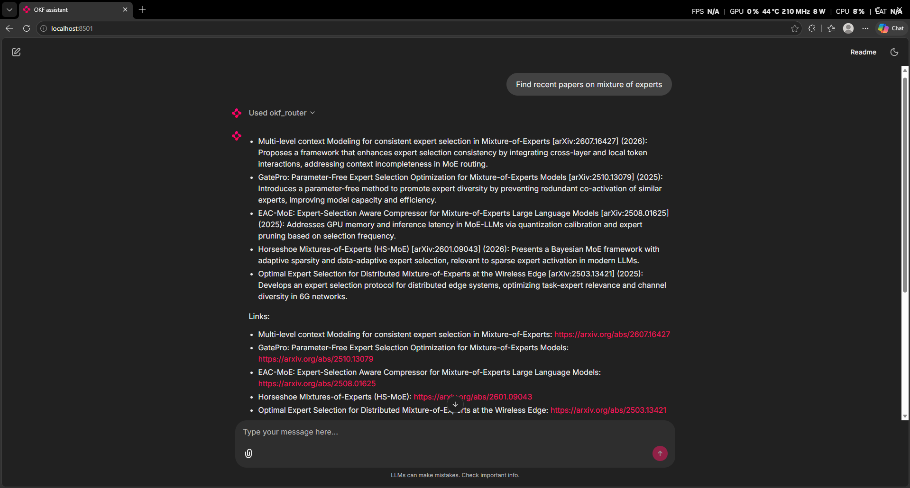
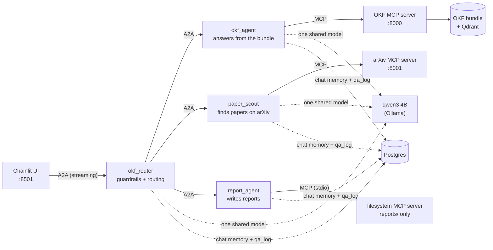

# OKF: a multi-agent research assistant over AI papers

Ask questions about five landmark AI papers and get cited answers, find newer papers on arXiv, and export the conversation as a report. It runs fully locally on a 6 GB laptop GPU.



**What it does**

- **Answers from the papers, with citations.** Every claim points to the section it came from, e.g. `[papers/gpt-4-technical-report/4-capabilities-part-1]`.
- **Finds newer work on arXiv** that isn't in the five papers.
- **Writes a Markdown report** of the conversation.
- **Guards itself.** It blocks prompt injection, masks pasted API keys, and repairs or removes made-up citations.
- **Streams answers** token by token into a chat UI that shows which agent answered and what it read.

The papers: *GPT-4 Technical Report*, *Sparks of AGI*, *HELM*, *A Survey of Large Language Models*, *On the Opportunities and Risks of Foundation Models* (775 pages in total).

---

## Architecture



- **Agents** are LangGraph graphs served by `langgraph dev`. They talk to each other with **A2A** (agent-to-agent protocol), so the router only knows the agents through their agent cards.
- **Tools** are MCP servers. One is ours (OKF search) and two are off the shelf (arXiv, filesystem).
- **One local model** (qwen3 4B, about 4 GB of VRAM) serves every agent.

---

## Why OKF hybrid: the evaluation

Four retrieval methods were built and compared on the same 30 questions (27 answerable, 3 not), all answered by the same qwen3 4B model:

| | OKF | **OKF hybrid** ✅ | Knowledge graph | Graph hybrid |
|---|---|---|---|---|
| Answers with **all** key facts | 81% | **89%** | 26% | 56% |
| Contextual recall (DeepEval) | **0.96** | 0.94 | 0.46 | 0.79 |
| Contextual precision | 0.76 | **0.76** | 0.53 | 0.60 |
| Answer relevancy | 0.99 | **1.00** | 0.85 | 0.99 |
| Faithfulness | **0.99** | 0.93 | 0.97 | 0.96 |
| Refused answerable questions | 0 / 27 | 0 / 27 | 6 / 27 | 0 / 27 |
| Retrieval time (median) | 7 ms | 1.6 s | 46 ms | 1.6 s |

*Scores from DeepEval with Mercury as the judge (it only judges; every answer comes from qwen 4B). "Key facts" is a check on the numbers and names in the reference answers.*

**Why OKF hybrid wins:**

- **Sections beat chunks.** OKF gives the model whole paper sections, so a table and the sentence next to a fact come along with it. The graph methods retrieve ~1,000-character chunks and lose facts that sit in the neighbouring chunk (for example GPT-4's "298/400" on the bar exam).
- **Curated topic pages link the papers.** A question like "How do the papers measure calibration?" lands on one topic page that already points to the right sections in every paper.
- **Hybrid search adds what keywords miss.** Dense, sparse and ColBERT re-ranking (Qdrant) on top of keyword search and links: 89% vs 81% for plain OKF.
- **The graph alone is too narrow.** It refused 6 answerable questions because no entity in the question matched the graph.

Caveat: 27 answerable questions is a small sample. OKF vs OKF hybrid is within noise, and plain OKF remains a solid fallback that needs no vector database.

## Building the knowledge: OKF bundle vs knowledge graph

The bigger difference was the cost of **building** the knowledge in the first place:

| | Knowledge graph (GraphRAG-style) | **OKF bundle** |
|---|---|---|
| How it's made | qwen3 4B extracts entities and relations from every chunk, then clusters them and writes a report per cluster | A script splits each paper into sections; a coding agent with an OKF skill writes the topic pages |
| LLM work | One local LLM call per chunk (2,927 chunks), plus one per community report | No LLM for the 798 sections; the agent writes 54 topic pages and 5 paper overviews |
| Time | **More than 10 hours** on a 6 GB GPU | **About 30 minutes** |
| Result | 2,394 entities, 2,801 facts, 130 community reports | 798 section pages + 59 curated pages, all plain Markdown |
| Quality issues | Vague relations, duplicate entities, extraction prompt needed several rounds of fixes | Topic pages are readable and checkable; every claim links to its source section |
| Changing it | Re-extract and re-cluster | Edit a Markdown file |
| Answer accuracy | 26% (graph) / 56% (hybrid) | 81% (OKF) / **89% (hybrid)** |

**Conclusion:** the OKF bundle was about 20× faster to build, is easy for a human to read and fix, and gave clearly better answers.

---

## Tech stack

| Layer | Tools |
|---|---|
| Model | qwen3 4B instruct (Q4_K_M) on Ollama; any OpenAI-compatible API as a drop-in |
| Retrieval | OKF bundle (Markdown) + BM25 + links; Qdrant hybrid search (MiniLM dense, BM25 sparse, ColBERT re-ranking) |
| Agents | LangGraph, served by `langgraph dev`; A2A between agents |
| Tools | MCP: our OKF server, `arxiv-mcp-server`, the official filesystem server |
| Memory and logs | Postgres (LangGraph checkpointer + a `qa_log` table); optional LangSmith tracing |
| Guardrails | Guardrails AI (hub validators + our own) |
| UI | Chainlit, streaming over A2A |
| Evaluation | DeepEval |
| PDF parsing | MinerU |

---

## Repository layout

```
OKF/
├── okf/               the retrieval + answering library          → okf/README.md
├── okf_mcp/           MCP server exposing OKF search              → okf_mcp/README.md
├── okf_agent/         the agents, router, guardrails, streaming   → okf_agent/README.md
├── ui/                Chainlit chat UI                            → ui/README.md
├── notebooks/         17 notebooks, one per step of the build     → notebooks/README.md
├── data/              source PDFs, parsed Markdown, eval questions → data/README.md
├── OKF_Bundle/        the knowledge bundle (sections + topic pages) → OKF_Bundle/README.md
├── artifacts/         generated files: graph, caches, eval results → artifacts/README.md
├── docs/images/       screenshots
├── reports/           reports written by report_agent (not in git)
├── langgraph.json     the four agents served by `langgraph dev`
├── pyproject.toml     package + optional dependency groups
└── start_backend.bat  starts all servers + the UI (Windows)
```

---

## Quick start

**Requirements:** Python 3.12 (conda), [Ollama](https://ollama.com), PostgreSQL, Node.js LTS (for the filesystem MCP server), a Qdrant Cloud cluster (free tier is enough). Optional: an NVIDIA GPU with 6 GB of VRAM.

```bash
# 1. environment
conda create -n okf python=3.12 -y
conda activate okf
pip install -e ".[agent]"            # add ",guard-ml" for the optional ML jailbreak detector

# 2. the model
ollama pull qwen3:4b-instruct-2507-q4_K_M
```

**3. `.env`** in the project folder (never commit it):

```ini
QDRANT_URL=https://<your-cluster>.qdrant.io
QDRANT_API_KEY=...
PG_HOST=localhost
PG_PORT=5432
PG_DBNAME=OKF
PG_USER=postgres
PG_PASSWORD=...
# optional
LANGSMITH_TRACING=true
LANGSMITH_API_KEY=...
OKF_GUARD_JAILBREAK=0
```

**4. Run.** With Ollama and Postgres running:

```bat
start_backend.bat
```

It opens four windows (OKF MCP server :8000, arXiv MCP server :8001, agent server :2024, chat UI :8501), and then your browser at **http://localhost:8501**.

You can also use the library on its own: `python -m okf "What score did GPT-4 get on the bar exam?"`

---

## Design decisions

- **A2A between agents, not function calls.** The router knows the other agents only through their agent cards, and the UI is just another A2A client. That's why the UI can run in its own environment (Chainlit's dependencies clash with `langgraph-api`'s).
- **One model call per answer.** okf_agent uses a fixed pipeline (search → answer → check), not a tool-calling loop. It's predictable on a 4B model, and it's the exact pipeline that was evaluated.
- **Guardrails were measured, not assumed.** An off-the-shelf ML jailbreak detector left a 0.005 margin between attacks and real questions in this domain (questions *about* LLMs look like attacks). It's off by default; regex rules plus limited agent permissions do the job. The output guard only touches citations, so accuracy is unchanged.
- **Streaming through two A2A hops.** Tokens flow Ollama → okf_agent → router → UI. The final guarded text then replaces the streamed draft.

## Limitations

- Evaluated on 30 questions: indicative, not conclusive.
- Single user, localhost only. No authentication, and chat history isn't listed in the UI after a reload.
- The OKF topic pages are marked `draft`: written by an agent from the sections, not yet reviewed line by line.
